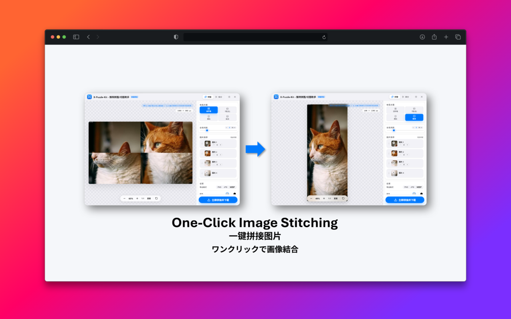
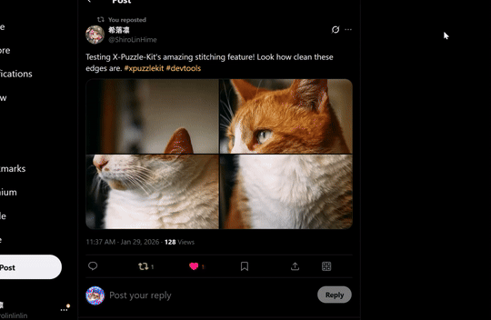
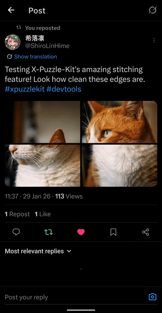
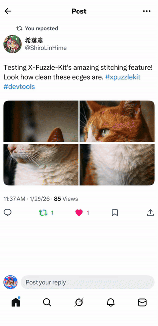

<div align="center">
  

  <h1>X-Puzzle-Kit</h1>
  <p>
    <b>Creative Image Stitching & Splitting Toolkit for X (Twitter)</b>
  </p>
  <p>
    <b>English</b> | <a href="./README_CN.md">简体中文</a> · <a href="https://x-puzzle-kit.pages.dev"><b>Online Web App ↗</b></a>
  </p>

  <p>
    <a href="https://github.com/Shirolin/X-Puzzle-Kit/actions">
      
    </a>
    <a href="https://github.com/Shirolin/X-Puzzle-Kit/releases/latest">
      
    </a>
    
    
  </p>

  <a href="https://x-puzzle-kit.pages.dev">
    
  </a>

  <br/>

  <p>
    <a href="https://x-puzzle-kit.pages.dev">
      
    </a>
    <a href="https://github.com/Shirolin/X-Puzzle-Kit/releases/latest">
      
    </a>
  </p>
</div>

<br/>

## ✨ Highlights

<div align="center">
  <table>
    <tr>
      <td align="center" width="33%"><b>Chrome Extension (Desktop)</b></td>
      <td align="center" width="33%"><b>Android (PWA)</b></td>
      <td align="center" width="33%"><b>iOS (Shortcut)</b></td>
    </tr>
    <tr>
      <td></td>
      <td></td>
      <td></td>
    </tr>
    <tr>
      <td align="center" valign="top">✨ <b>Timeline Integration</b><br/>Right-click to split</td>
      <td align="center" valign="top">🚀 <b>System Share Target</b><br/>Add to Home Screen</td>
      <td align="center" valign="top">📲 <b>Shortcut Integration</b><br/>One-click from X app</td>
    </tr>
  </table>
  <p><i>Seamless workflow from Desktop Extension to Mobile PWA</i></p>
</div>

### 🖼️ Stitch & Collect (Stitcher)

- **Creative Assembly**: Love multi-panel illustrations or comic spreads on X? Grab all images from a post in one click and **stitch them into a full-resolution image** for your collection.
- **Smart Layout Prediction**: Automatically chooses the best layout (2x2 Grid, adaptive multi-row grid for 5+ images, T-Shape, Horizontal, or Vertical) based on image count and aspect ratios.
- **Native Integration (Extension only)**: Adds a Stitch button directly to multi-image posts on X so you can combine images without saving them first.

### ✂️ Smart Splitter

- **Multi-Mode Splitting**: Supports **2x2 Grid**, **T-Shape (1 large, 2 small)**, **Horizontal (Nx1, up to 20 slices)**, and **Vertical (1xN, up to 20 slices)**—ideal for X's 4-image grid or vertical strip comics.
- **Precision Editing**: Switch between **Unified** and **Individual** drag modes to pan and scale globally or fine-tune each cell independently, including **replacing images** per cell.
- **Twitter "Seamless Flow" Layout**: One-click aspect-ratio optimization matches X's preview ratios so split slices align seamlessly in the timeline.
- **Post to X & Flexible Export**: Trim built-in source gaps, fill exposed edges with a background color, download individually or as a **ZIP archive**, or use **Post to X** (direct post composer attachment in the extension; system share menu or ZIP/image download on Web).

### 📱 Platform

- **PWA & Mobile**: Full PWA support with a touch-friendly UI for iOS and Android.
- **Instant Updates**: Web and PWA updates ship immediately without waiting for extension store review.
- **Mobile Integration**: Import posts directly via the system Share menu from the **X mobile app or mobile web**, powered by **Web Share Target** (Android) and **Shortcuts** (iOS).

### 🔒 Privacy

- **Chrome Extension**: **100% local processing** in your browser, with zero uploads to X-Puzzle-Kit servers.
- **Web / PWA**: Uses a stateless proxy (Cloudflare Workers / Pages Functions) only to parse tweet URLs and relay CORS-restricted X media, without storing personal data or usage logs. Image stitching and splitting always stay local in your browser. See the [Privacy Policy](./doc/privacy.md) for details.

## 📦 Installation

### Method 1: Web App / PWA (Easiest)

No installation required! Visit the Web App and add it to your Home Screen for an app-like experience.

- **URL (Cloudflare Pages)**: [https://x-puzzle-kit.pages.dev](https://x-puzzle-kit.pages.dev)
- **Product Site (GitHub Pages)**: [https://shirolin.github.io/X-Puzzle-Kit/](https://shirolin.github.io/X-Puzzle-Kit/)
- **Features**: Supports sharing posts directly from the **X mobile app or mobile web** via the system Share menu.

### Method 2: Chrome Extension (Best for Desktop)

The most efficient way for desktop users.

1. **Web Store (Recommended)**: [Chrome Web Store ↗](https://chromewebstore.google.com/detail/x-puzzle-kit-stitch-split/nadlbdmcfmjinifkoedegmiejfibdikk) Click "Add to Chrome".
2. **Manual Install (Alternative)**:
   - Download the latest `.zip` from the [Releases Page](https://github.com/Shirolin/X-Puzzle-Kit/releases/latest) and unzip it.
   - Go to `chrome://extensions/` in Chrome and enable "Developer mode".
   - Click "Load unpacked" and select the unzipped folder.

### Method 3: Build from Source

For developers who want to contribute or build from source:

```bash
git clone https://github.com/Shirolin/X-Puzzle-Kit.git
cd X-Puzzle-Kit
npm install
npm run build      # Build Chrome Extension (dist)
npm run build:web  # Build Web/PWA Version (dist-web)
# For extension, load the 'dist' directory in Chrome
```

## 🛠️ Tech Stack

Built with modern web technologies for speed and reliability:

- **Framework**: [Preact](https://preactjs.com/) (with `preact/compat`)
- **Language**: [TypeScript](https://www.typescriptlang.org/)
- **Build Tool**: [Vite](https://vitejs.dev/)
- **Components**: [Lucide](https://lucide.dev/), [Sonner](https://sonner.stevenly.me/), [SortableJS](https://sortablejs.com/), [JSZip](https://stuk.github.io/jszip/)
- **Styling**: Vanilla CSS (CSS Custom Properties)

## 🔖 Release & Build

This project uses an automated release workflow.

### Automated Release

Simply push a version tag, and GitHub Actions will automatically package and release it:

```bash
npm version patch  # or minor / major
git push --follow-tags
```

### Manual Packaging

To build the `.zip` package locally:

```bash
npm run package
```

The artifact is generated in the `release/` directory. Upload that ZIP to the Chrome Web Store, or unzip it and use "Load unpacked" in `chrome://extensions`. No `.crx` is produced — a CRX requires a fixed private key to yield a stable extension ID, which the store does not accept anyway.

## 🤝 Contribution & Support

[Issues](https://github.com/Shirolin/X-Puzzle-Kit/issues) and Pull Requests are welcome!

If you find this project helpful, please give it a Star ⭐️ or buy me a coffee:

- [Afdian](https://ifdian.net/a/shirolin)
- [Ko-fi](https://ko-fi.com/shirolin)

### More extensions by the same author

- **[PostPress](https://chromewebstore.google.com/detail/mfmldbbkajimckojjgceehiackjpakai)** — Copy any post or thread on X as a print-grade 3× card, straight to your clipboard.
- **[Imaget](https://chromewebstore.google.com/detail/kjnhapjhnhlilcngmhggiaaljddadjek)** — Sniff and batch-download every image on a page.

## 📄 License

[GPL-3.0](./LICENSE) License © 2026 shirolin
