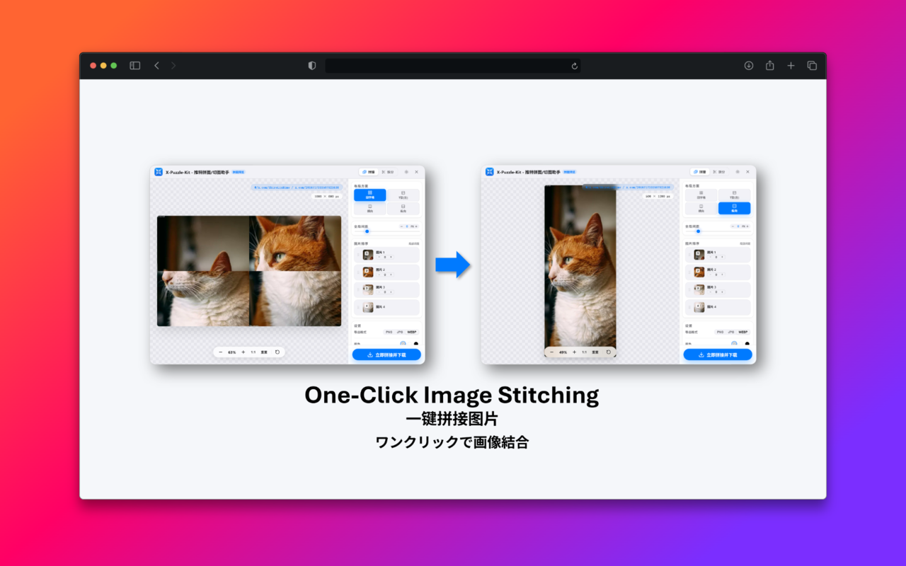
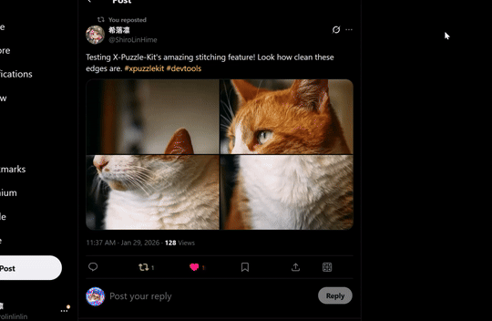
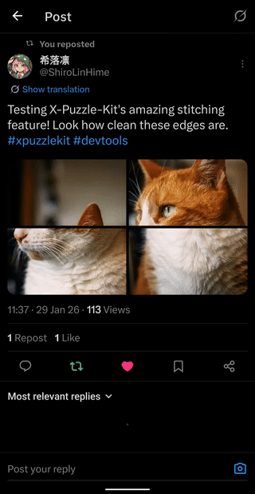
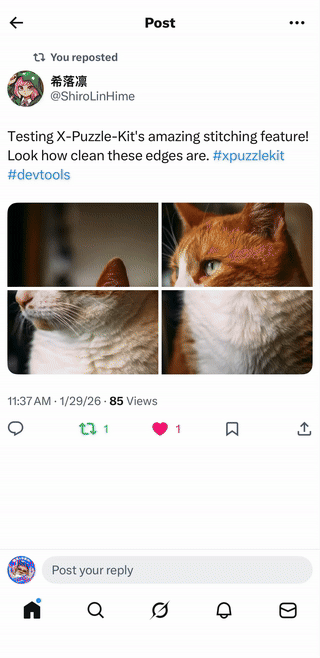

<div align="center">
  

  <h1>X-Puzzle-Kit</h1>
  <p>
    <b>X (Twitter) 创意拼图与切图工具箱</b>
  </p>
  <p>
    <a href="./README.md">English</a> | <b>简体中文</b> · <a href="https://x-puzzle-kit.pages.dev"><b>在线工作台 (PWA) ↗</b></a>
  </p>

  <p>
    <a href="https://github.com/Shirolin/X-Puzzle-Kit/actions">
      
    </a>
    <a href="https://github.com/Shirolin/X-Puzzle-Kit/releases/latest">
      
    </a>
    
    
  </p>

  <a href="https://x-puzzle-kit.pages.dev">
    
  </a>

  <br/>

  <p>
    <a href="https://x-puzzle-kit.pages.dev">
      
    </a>
    <a href="https://github.com/Shirolin/X-Puzzle-Kit/releases/latest">
      
    </a>
  </p>
</div>

<br/>

## ✨ 核心亮点

<div align="center">
  <table>
    <tr>
      <td align="center" width="33%"><b>Chrome 扩展 (桌面端)</b></td>
      <td align="center" width="33%"><b>Android (PWA)</b></td>
      <td align="center" width="33%"><b>iOS (快捷指令)</b></td>
    </tr>
    <tr>
      <td></td>
      <td></td>
      <td></td>
    </tr>
    <tr>
      <td align="center" valign="top">✨ <b>信息流按钮嵌入</b><br/>右键快捷拆切</td>
      <td align="center" valign="top">🚀 <b>系统分享直达</b><br/>添加到主屏幕</td>
      <td align="center" valign="top">📲 <b>快捷指令联动</b><br/>官方菜单一键直连</td>
    </tr>
  </table>
  <p><i>从桌面端扩展到移动端 PWA，全平台无缝体验</i></p>
</div>

### 🖼️ 拼图与收藏 (Stitcher)

- **创意还原**: 看到画师利用 X 机制巧妙设计的 4 分割、多图拼版或连载漫画？一键抓取推文原图，**无损合成为完整高清大图**，方便保存收藏。
- **智能布局**: 根据图片数量与比例自动推荐最佳布局（田字格、5 张及以上自适应多行网格、T 型、横向或纵向），支持原图画质处理。
- **原生集成 (仅限插件)**: 直接在多图推文操作栏嵌入拼接按钮，无需逐张下载即可一键打开拼图。

### ✂️ 智能拆图 (Smart Splitter)

- **多模式切分**: 提供 **田字格 (2x2)**、**T 型（1 大 2 小）**、**横向 (Nx1，最多 20 张)** 与 **纵向 (1xN，最多 20 张)** 多种布局，适配 X 四图流或长条漫展示。
- **精细化编辑**: 支持 **整体 (Unified)** 与 **分别 (Individual)** 两种拖拽模式，既可统筹全局缩放移动，也能单独微调每个格子并**替换单格图片**。
- **一图流布局优化**: 内置一键 **推特「一图流」布局优化**，自动适配时间线预览比例，让多张切图在信息流中无缝衔接。
- **快捷发推与灵活导出**: 支持**消除原图间隙**与**底色填充**，可单独下载或打包为 **ZIP 压缩包**；也可通过 **发布到 X** 直接将切图填入推文编辑器（插件端），或在移动端与网页端调用系统分享及下载引导。

### 📱 跨平台体验 (Platform)

- **深度适配**: 完善的 PWA 支持，针对 iOS 与 Android 优化的触控界面。
- **即时更新**: 网页与 PWA 版本可直接推送更新（尤其适合通过 iOS 快捷指令唤起时），无需等待扩展商店审核周期。
- **系统集成 (仅限移动端)**: 支持从移动端 App 或网页版通过系统“分享”菜单将推文直传工具——Android 端基于 **Web Share Target**，iOS 端基于**快捷指令**。

### 🔒 隐私保护

- **插件版**: **100% 纯本地处理**，不向 X-Puzzle-Kit 服务器上传图片内容、链接或设置。
- **Web / PWA 版**: 仅在解析推文链接与跨域拉取 X 媒体时经由无状态安全代理（Cloudflare Workers / Pages Functions）中转，不记录个人使用日志；所有拼图与切图运算均在本地 Canvas 完成。详见 [隐私政策](./doc/privacy.md)。

## 📦 安装指南

### 方法一：直接使用 Web 版 / PWA (推荐)

无需安装，即点即用！您可以直接访问网页版，并将其“添加到主屏幕”以获得原生 App 般的体验。

- **访问地址 (Cloudflare Pages)**: [https://x-puzzle-kit.pages.dev](https://x-puzzle-kit.pages.dev)
- **产品官网 (GitHub Pages)**: [https://shirolin.github.io/X-Puzzle-Kit/](https://shirolin.github.io/X-Puzzle-Kit/)
- **特色功能**: 支持在**移动端**通过系统“分享”菜单将推文（App 或网页版）直接导入处理。

### 方法二：Chrome 浏览器扩展 (桌面端推荐)

这是桌面端用户的最佳体验方式。

1. **前往应用商店 (推荐)**: [Chrome 网上应用店 ↗](https://chromewebstore.google.com/detail/x-puzzle-kit-stitch-split/nadlbdmcfmjinifkoedegmiejfibdikk) 点击“添加至 Chrome”。
2. **手动加载 (开发者/备选)**:
   - 前往 [Releases 页面](https://github.com/Shirolin/X-Puzzle-Kit/releases/latest) 下载最新的 `.zip` 文件并解压。
   - 打开 Chrome，访问 `chrome://extensions/` 并开启“开发者模式”。
   - 点击“加载已解压的扩展程序”，选择解压后的文件夹。

### 方法三：源码编译安装

如果您是开发者，可以从源码构建：

```bash
git clone https://github.com/Shirolin/X-Puzzle-Kit.git
cd X-Puzzle-Kit
npm install
npm run build      # 构建 Chrome 扩展 (dist)
npm run build:web  # 构建 Web/PWA 版本 (dist-web)
# 扩展版请在 Chrome 加载 dist 目录
```

## 🛠️ 技术栈

本项目基于现代 Web 技术构建，兼顾性能与开发体验：

- **Framework**: [Preact](https://preactjs.com/)（兼容 `preact/compat`）
- **Language**: [TypeScript](https://www.typescriptlang.org/)
- **Build Tool**: [Vite](https://vitejs.dev/)
- **Components**: [Lucide Icons](https://lucide.dev/), [Sonner](https://sonner.stevenly.me/) (Toasts), [SortableJS](https://sortablejs.com/), [JSZip](https://stuk.github.io/jszip/)
- **Styling**: 原生 CSS（CSS 变量与 Apple 风格视觉系统）

## 🔖 版本发布与构建

本项目采用自动化流程管理发布。

### 自动发布

只需推送版本标签，GitHub Actions 会自动打包并发布 Release：

```bash
npm version patch  # 或 minor / major
git push --follow-tags
```

### 手动打包

构建 `.zip` 包：

```bash
npm run package
```

产物将生成在 `release/` 目录下。将该 ZIP 上传至 Chrome 网上应用店，或解压后在 `chrome://extensions` 中“加载已解压的扩展程序”。不再产出 `.crx` —— CRX 需要固定私钥才能得到稳定的扩展 ID，而商店只接收 ZIP 并自行重签名。

## 🤝 贡献与支持

欢迎提交 [Issue](https://github.com/Shirolin/X-Puzzle-Kit/issues) 或 Pull Request！

如果这个项目对您有帮助，请给项目点个 Star ⭐️，或请作者喝杯咖啡：

- [爱发电 (Afdian)](https://ifdian.net/a/shirolin)
- [Ko-fi](https://ko-fi.com/shirolin)

### 同作者的其他扩展

- **[PostPress](https://chromewebstore.google.com/detail/mfmldbbkajimckojjgceehiackjpakai)** —— 把 X 上的推文或长串一键复制成出版级 3× 卡片。
- **[Imaget](https://chromewebstore.google.com/detail/kjnhapjhnhlilcngmhggiaaljddadjek)** —— 嗅探并批量下载页面上的所有图片。

## 📄 许可证

[GPL-3.0](./LICENSE) License © 2026 shirolin
